# Developing MontClip

Developer notes, moved here from the README.

## Quick start

Run it from a clone:

```bash
git clone https://github.com/good-night-oppie/MontClip.git
cd MontClip
node server.js        # → http://localhost:7777
```

Projects, media and exports go to the default data folder next to `server.js`; set `FABLECUT_DATA_DIR` to put them elsewhere.

Requirements: **Node 18+** and a Chromium-based browser. **ffmpeg on PATH** is
optional but recommended (fast export + upload remuxing). AI background
removal fetches its model from a CDN on first use.

The server binds **127.0.0.1 only** (v1.3.1+). To use it from another device on
your LAN, opt in explicitly: `HOST=0.0.0.0 FABLECUT_ALLOWED_HOSTS=<your-ip> node server.js`.

Drop media into the window (or `./media/`), paste an HTTPS URL via **+ URL**,
drag clips onto the timeline, edit, export.

To keep your work outside the checkout, set **`FABLECUT_DATA_DIR`** — it moves
`project.json`, `media/`, `exports/`, `analysis/` and `library/` to a directory
you choose. Leave it unset and everything stays in the repo, exactly as before.

### Or install it as a Claude Code plugin

```
/plugin marketplace add ronak-create/FableCut
/plugin install fablecut@fablecut
```

That registers the MCP server for you and adds three skills — `edit-video`,
`remake-reel` and `motion-graphics`. Your timeline and footage live in the plugin's own data
directory, so an update never touches them. Node 18+ and (optionally) ffmpeg
still need to be on your machine.

## Driving it with an AI agent

Everything an agent needs is in **[CLAUDE.md](CLAUDE.md)** — the complete
schema, semantics and recipes. Point any capable model at that file and it can
operate the editor end to end.

> 📖 **Browsable docs:** the same manual as web pages, one page per topic
> (MCP tools, the `project.json` schema, clip props, recipes, REST API,
> export): **[fablecut.space/docs](https://fablecut.space/docs/)**.

Three equivalent control surfaces:

1. **MCP** (best for Claude Code / Claude Desktop) — register the bundled
   zero-dependency MCP server once:

   ```bash
   claude mcp add -s user fablecut -- npx -y fablecut mcp
   ```

   No clone or path needed; your work lives in `~/FableCut`. From a clone,
   point at the file instead:

   ```bash
   claude mcp add -s user fablecut -- node "<path-to>/fablecut/mcp-server.js"
   ```

   **OpenCode** can use the same stdio server from its project or global
   `opencode.json` configuration:

   ```json
   {
     "$schema": "https://opencode.ai/config.json",
     "mcp": {
       "fablecut": {
         "type": "local",
         "command": ["node", "/absolute/path/to/MontClip/mcp-server.js"],
         "enabled": true
       }
     }
   }
   ```

   For another MCP client, register a local stdio server with this equivalent
   command. The exact key names vary by client, but the command and arguments
   do not:

   ```json
   {
     "name": "fablecut",
     "transport": "stdio",
     "command": "npx",
     "args": ["-y", "fablecut", "mcp"]
   }
   ```

   (From a clone: `"command": "node"`, `"args": ["/absolute/path/to/MontClip/mcp-server.js"]`.)

   The server is intentionally client-neutral. It speaks MCP over stdio and
   does not require Claude-specific environment variables. With a clone, keep
   the path absolute. Node 18 or newer either way.

   Tools: `fablecut_status` (auto-starts the editor), `fablecut_docs`,
   `fablecut_get_project`, `fablecut_set_project`, `fablecut_patch_project`,
   `fablecut_import_media`, `fablecut_analyze_reference`, `fablecut_frame`,
   `fablecut_encode_profiles`, `fablecut_normalize_audio`, `fablecut_auto_duck`,
   `fablecut_denoise`, `fablecut_silence`, `fablecut_beats`, `fablecut_reframe`, `fablecut_highlights`, `fablecut_transcribe`, `fablecut_captions`, `fablecut_export`, `fablecut_scopes`, `fablecut_track`.

   The upstream project ([ronak-create/FableCut](https://github.com/ronak-create/FableCut)) is also published on the **official MCP registry** as
   [`io.github.ronak-create/fablecut`](https://registry.modelcontextprotocol.io/v0/servers?search=fablecut)
   — each release ships an MCPB bundle (`fablecut.mcpb`) that MCPB-capable
   clients can install directly.

   The surface is **token-efficient by design**: agents patch the timeline with
   small ops (`fablecut_patch_project`) instead of round-tripping the whole
   document, read a compact one-line-per-clip summary
   (`fablecut_get_project {compact:true}`), and fetch only the manual sections
   they need (`fablecut_docs {section:"props"}`).
2. **The file** — read `project.json`, modify, bump `revision`, write. The UI
   live-reloads.
3. **REST** — `GET/PUT /api/project`, `POST /api/upload`, `POST /api/import-url`,
   `GET /api/library`, `GET /api/export/profiles`, SSE at `/api/events`. See
   CLAUDE.md for the full list.

Example: ask Claude Code *"cut these six clips to the beat markers, add a
teal-orange grade, put a word-pop caption on top and a whoosh on every cut"* —
and watch the timeline rebuild itself.

Or hand it a reference: *"here's a reel I like — analyze it and remake it with
my clips, same music"*. The agent calls `fablecut_analyze_reference`, gets the
blueprint (cuts, beats, BPM, energy, drop, extracted music), and rebuilds the
structure shot-for-shot with your footage.

**The agent can see, not just measure.** `fablecut_analyze_reference` gives it
the *ears* — where the cuts land, which shots hit hard. `fablecut_frame` gives it
the *eyes*: ask for any moment of any clip (`{path, t:3.2}`) and the call comes
back with an actual image the model can look at, or ask for a 12-frame contact
sheet to survey a whole clip in one call (`{path, frames:12}`). Pass a `time`
with no `path` and it renders the composed timeline — graded, all tracks, exactly
as export would. So footage gets chosen by looking at it rather than guessing
from a number, and a grade gets checked against the real picture.

**Conflict-safe concurrent editing**: the UI, the MCP tools, and direct
`project.json` writes all agree on a `revision` counter. If you edit a clip in
the UI while an agent is mid-task, the agent's next write is rejected (409 from
the REST API / a conflict error from `fablecut_set_project`) instead of
silently overwriting your change. The UI similarly detects when an agent write
supersedes a not-yet-saved local tweak and tells you with a toast instead of
dropping it silently.

## Project layout

```
server.js        zero-dependency HTTP server: static hosting, REST API, SSE,
                 ffmpeg export pipeline
app.js           the editor: timeline UI, compositor, keyframes, text engine,
                 SVG rasterizer, chroma key, exporters
index.html       single-page UI
style.css        dark editor theme
mcp-server.js    stdio MCP server exposing the editor to AI agents
analyze.js       reference-video analyzer: shots, beats/BPM, energy, drop,
                 music extraction (module + CLI)
CLAUDE.md        the agent manual (schema + recipes) — also served by fablecut_docs
encoding-profiles.json
                 Fast-export ffmpeg presets (hot-reloaded)
project.json     your timeline (created on first run; gitignored)
media/           project footage (gitignored)
analysis/        cached edit blueprints from /api/analyze (gitignored)
library/         default assets: elements/ sfx/ svg/ fonts/
exports/         finished renders (gitignored)
```

## Architecture Overview

```mermaid
flowchart TD

subgraph group_interaction["Editing Experience"]
  node_browser_ui["Browser Editor<br/>[app.js]"]
  node_timeline_model["Timeline Model<br/>[app.js]"]
  node_ruler_worker["Ruler Worker<br/>[ruler-worker.js]"]
end

subgraph group_project_media["Project And Media"]
  node_project_store[("Project Store<br/>[paths.js]")]
  node_media_store[("Media Store<br/>[paths.js]")]
  node_asset_library[("Asset Library<br/>[server.js]")]
  node_url_importer["URL Importer<br/>[import-url.js]"]
end

subgraph group_agent_api["Agent Control"]
  node_rest_api["REST Server<br/>[server.js]"]
  node_mcp_server["MCP Server<br/>[mcp-server.js]"]
  node_sse_hub["Change Notifications<br/>[server.js]"]
end

subgraph group_playback_export["Playback And Export"]
  node_compositor["Canvas Compositor<br/>[app.js]"]
  node_audio_engine["Audio Engine<br/>[app.js]"]
  node_audio_meter["Audio Meter<br/>[meter-worklet.js]"]
  node_export_engine["Export Engine<br/>[server.js]"]
  node_encoding_profiles["Encoding Profiles<br/>[encode-profiles.js]"]
end

subgraph group_analysis["Analysis Tools"]
  node_reference_analyzer["Reference Analyzer<br/>[analyze.js]"]
end

node_human(("Human Editor"))
node_ai_agent(("AI Agent"))
node_ffmpeg["FFmpeg"]

node_human -->|"edits timeline"| node_browser_ui
node_ai_agent -->|"sends tools"| node_mcp_server
node_browser_ui -->|"updates project"| node_timeline_model
node_timeline_model -->|"persists JSON"| node_project_store
node_browser_ui -->|"calls REST"| node_rest_api
node_rest_api -->|"reads writes"| node_project_store
node_rest_api -->|"serves media"| node_media_store
node_rest_api -->|"lists assets"| node_asset_library
node_mcp_server -->|"checks server"| node_rest_api
node_mcp_server -->|"patches project"| node_project_store
node_mcp_server -->|"imports media"| node_url_importer
node_url_importer -->|"stores downloads"| node_media_store
node_rest_api -->|"downloads URLs"| node_url_importer
node_rest_api -->|"broadcasts changes"| node_sse_hub
node_sse_hub -->|"pushes changes"| node_browser_ui
node_timeline_model -->|"renders timeline"| node_compositor
node_timeline_model -->|"routes clips"| node_audio_engine
node_audio_engine -->|"measures audio"| node_audio_meter
node_browser_ui -->|"uploads frames"| node_rest_api
node_rest_api -->|"streams export"| node_export_engine
node_export_engine -->|"loads profile"| node_encoding_profiles
node_export_engine -->|"encodes video"| node_ffmpeg
node_reference_analyzer -->|"analyzes media"| node_ffmpeg
node_reference_analyzer -->|"writes music"| node_media_store
node_ai_agent -.->|"requests analysis"| node_reference_analyzer
node_browser_ui -.->|"draws ruler"| node_ruler_worker

click node_browser_ui "https://github.com/ronak-create/fablecut/blob/main/app.js"
click node_timeline_model "https://github.com/ronak-create/fablecut/blob/main/app.js"
click node_compositor "https://github.com/ronak-create/fablecut/blob/main/app.js"
click node_audio_engine "https://github.com/ronak-create/fablecut/blob/main/app.js"
click node_audio_meter "https://github.com/ronak-create/fablecut/blob/main/meter-worklet.js"
click node_rest_api "https://github.com/ronak-create/fablecut/blob/main/server.js"
click node_mcp_server "https://github.com/ronak-create/fablecut/blob/main/mcp-server.js"
click node_sse_hub "https://github.com/ronak-create/fablecut/blob/main/server.js"
click node_project_store "https://github.com/ronak-create/fablecut/blob/main/paths.js"
click node_media_store "https://github.com/ronak-create/fablecut/blob/main/paths.js"
click node_asset_library "https://github.com/ronak-create/fablecut/blob/main/server.js"
click node_url_importer "https://github.com/ronak-create/fablecut/blob/main/import-url.js"
click node_export_engine "https://github.com/ronak-create/fablecut/blob/main/server.js"
click node_encoding_profiles "https://github.com/ronak-create/fablecut/blob/main/encode-profiles.js"
click node_reference_analyzer "https://github.com/ronak-create/fablecut/blob/main/analyze.js"
click node_ruler_worker "https://github.com/ronak-create/fablecut/blob/main/ruler-worker.js"

classDef toneNeutral fill:#f8fafc,stroke:#334155,stroke-width:1.5px,color:#0f172a
classDef toneBlue fill:#dbeafe,stroke:#2563eb,stroke-width:1.5px,color:#172554
classDef toneAmber fill:#fef3c7,stroke:#d97706,stroke-width:1.5px,color:#78350f
classDef toneMint fill:#dcfce7,stroke:#16a34a,stroke-width:1.5px,color:#14532d
classDef toneRose fill:#ffe4e6,stroke:#e11d48,stroke-width:1.5px,color:#881337
classDef toneIndigo fill:#e0e7ff,stroke:#4f46e5,stroke-width:1.5px,color:#312e81
classDef toneTeal fill:#ccfbf1,stroke:#0f766e,stroke-width:1.5px,color:#134e4a
class node_browser_ui,node_timeline_model,node_ruler_worker toneBlue
class node_project_store,node_media_store,node_asset_library,node_url_importer toneAmber
class node_rest_api,node_mcp_server,node_sse_hub toneMint
class node_compositor,node_audio_engine,node_audio_meter,node_export_engine,node_encoding_profiles toneRose
class node_reference_analyzer,node_human,node_ai_agent,node_ffmpeg toneIndigo
```



## Authoring animated SVG overlays

SVGs animate with plain CSS `@keyframes`. One convention: never hardcode
`animation-delay` — set `--d: 0.4s` instead, and the compositor drives time by
pausing all animations and rebasing their delays. Full rules + a skeleton in
[CLAUDE.md](CLAUDE.md#authoring-animated-svgs-the-svg-clip-kind); working
examples in [`library/svg/`](library/svg/).

## Notes

- The repo ships with **20 Google Fonts** (`library/fonts/`, OFL — see
  `LICENSES.md` there) and a set of self-authored SVG overlays and animated
  elements (`library/elements/`, `library/svg/`, MIT like the rest of the repo).
- `library/sfx/` is yours to fill (gitignored): sound-effect sites typically
  don't allow redistributing their files in a public repo, so MontClip doesn't —
  `library/sfx/README.md` lists good free sources.
- Export runs in the browser because the compositor *is* the browser; agents
  ask you to click Export (or render directly with ffmpeg from `media/`).

Subtitle parsing preserves complete normalized SRT/WebVTT cue text, including long Chinese/Unicode lines, instead of silently truncating at 500 code units. Display layout and import fitting remain separate from this parser correction.

### MontClip view preferences

The shared editor DOM has Simple/Advanced layout controls, Chinese/English labels
for these controls, and persistent local view preferences. This does not translate
all existing editor panels. Mode/language changes do not replace the project or
undo history. Undo/redo buttons use the existing editor commands. The collapsible
Assistant panel states that no AI service is connected; it sends nothing.
FLV import, broader localization and interactive chat are separate changes.

Desktop view preferences (simple/advanced and zh-CN/en) use the fixed userData/view-settings.json file, independent of the random local server port. The sandboxed preload exposes only get/set for these two enum settings; main validates sender, top frame and exact origin. Browser use retains localStorage. This does not save project edits.
