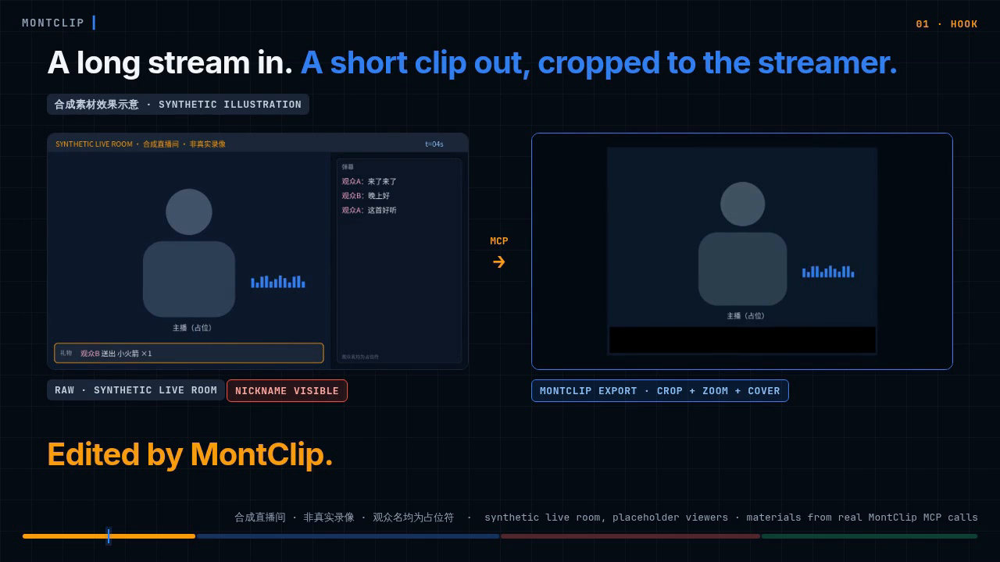

# MontClip

**MontClip: a video editor for streamers who cut their own streams.** Bring in your recordings, pick the parts to keep sentence by sentence from the subtitles, and export an MP4 with subtitles. Keeping by sentence and subtitle export are still being verified; what works today is importing and exporting MP4.

There is no installer yet: for now you run it from source. [Get started](#get-started) · [What it can do today](#what-it-can-do-today) · [Not available yet](#planned) · [简体中文](docs/i18n/README.zh-CN.md)

Based on [ronak-create/FableCut](https://github.com/ronak-create/FableCut) (MIT).

<p align="center">
  
  <br><sub>Demo (22 seconds, synthetic footage, not a real recording). <a href="https://github.com/good-night-oppie/MontClip/releases/tag/readme-demo-2026-11-07">Watch the demo video</a></sub>
</p>

## What it can do today

- **Import local recordings**: add video files from your computer to a project.
- **Export MP4**: export the finished clip as MP4.

Your recordings are processed on your computer by default. Going online only happens inside features you turn on yourself, and you see what will be sent before it goes out.

## Get started

There is no installer yet. For now MontClip runs from source, the developer way.

You need:

- [Git](https://git-scm.com/downloads) (to download MontClip)
- [Node.js](https://nodejs.org/) 18 or newer
- A Chromium-based browser (Chrome or Edge)
- Recommended: [FFmpeg](https://ffmpeg.org/download.html) 6.0 or newer, for fast export. If it is missing, MontClip tells you.

So far these steps have been walked through on Windows 11; on Linux, only starting MontClip has been tried.

Then, in a terminal:

```bash
git clone https://github.com/good-night-oppie/MontClip.git
cd MontClip
node server.js
```

Open <http://localhost:7777> in your browser. Keep the terminal window open while you edit. You start with an empty project. To bring in a video, drag it into the window, or click **+ 导入** (the Import button; most of the interface is in Chinese for now). If you don't see that button, open the **素材** (Media) panel first. If the terminal says `EADDRINUSE`, port 7777 is already in use, often by a MontClip you started earlier. Close that one first; otherwise the page you open is the old one. Your projects and exports are saved next to `server.js`; to keep them somewhere else, see [DEVELOPMENT.md](DEVELOPMENT.md).

## Planned

These are still in progress or not yet verified, and are not available now:

- Keep by sentence: still being verified; it counts only once verified.
- Export a matching SRT subtitle file: still being verified.
- Optional AI assistant (you see what is sent before it goes out): still being verified.
- More of the interface in Chinese (some panels and dialogs are still in English)
- An installer (for now MontClip runs the developer way)
- Cutting Chinese by individual words (Chinese transcription currently has sentence-level timing only)
- macOS and Linux versions (only tested on Windows so far)

## About the upstream project

MontClip is a modified version of FableCut and keeps its MIT license. FableCut has many more features that MontClip has not verified one by one, so they are not listed here. See the [upstream FableCut documentation](https://github.com/ronak-create/FableCut).

## License

MIT. See [LICENSE](LICENSE) and the [third-party notices](LICENSES.md).

## For developers

Running from source in detail: [DEVELOPMENT.md](DEVELOPMENT.md). Architecture diagrams, export and agent/API notes: [technical reference](docs/technical-reference.md).
