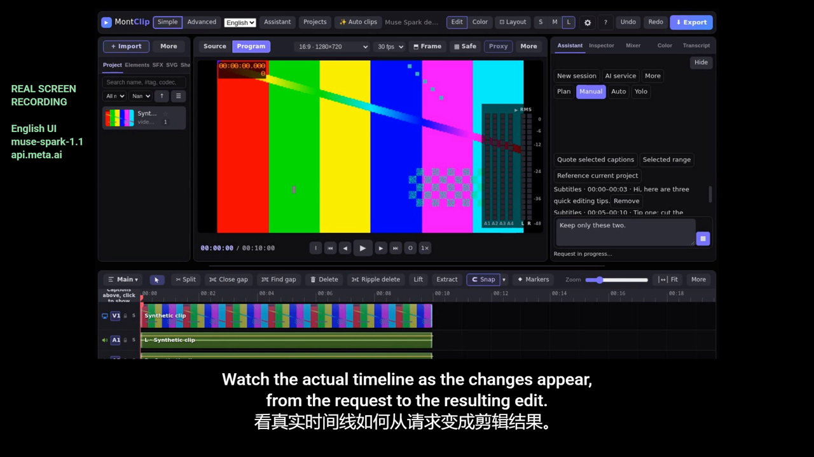
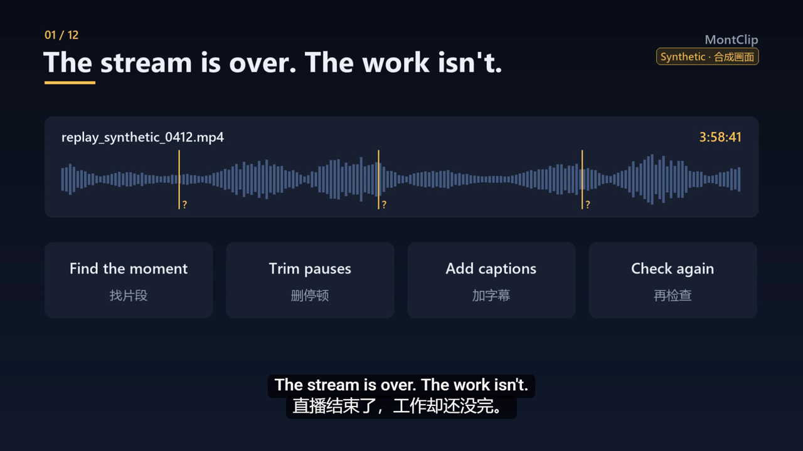
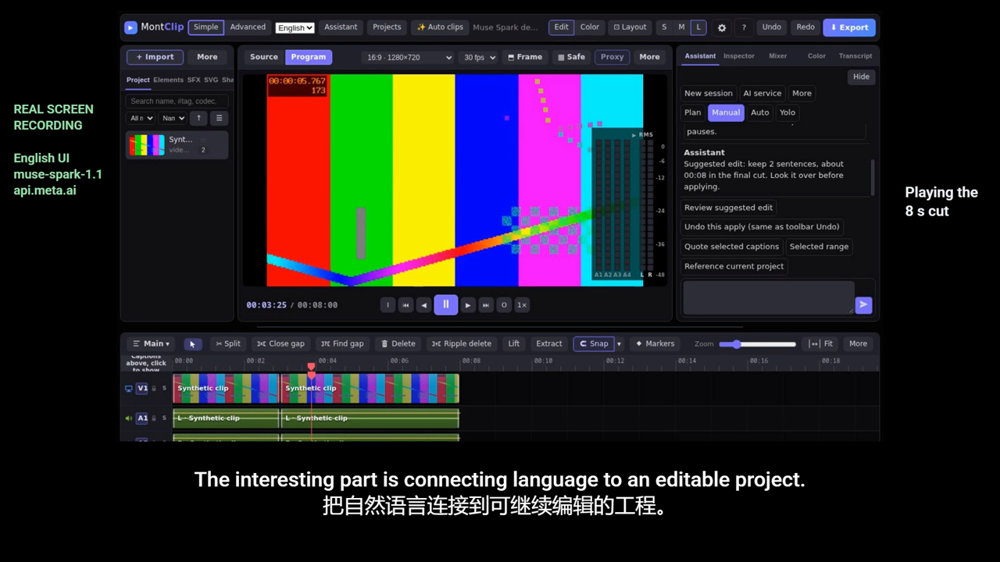
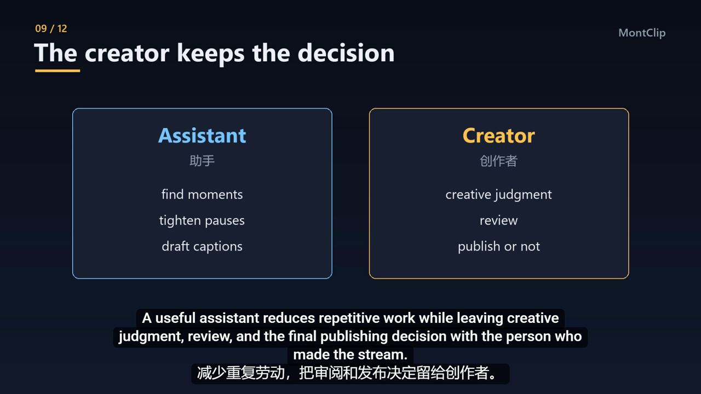

<div align="center">

# MontClip

**Edit your stream by talking to it. Review every outgoing request. Choose when edits need your approval. Every applied edit is one Undo away.**

A desktop video editor for streamers who cut their own streams. Chinese first, English one click away.
Built for the **Meta AI Developer Hackathon** with **Muse Spark** on the **Meta Model API**.

[▶ Watch the 3-minute demo](https://github.com/good-night-oppie/MontClip/releases/tag/meta-hackathon-demo) ·
[简体中文](../i18n/README.zh-CN.md) ·
[How the Muse Spark integration works](#how-muse-spark-is-wired-in) ·
[Run it](#run-it)

   



</div>

## The problem



A four-hour stream turns into a few short clips, and the streamer usually cuts them alone, after the stream, when they are tired. Most of that time is spent on repetitive work: finding the moment, trimming pauses, adding captions, checking it again. MontClip keeps that work in one editor and lets the streamer hand the repetitive part to an assistant in plain language, while the creative decisions stay with them.

## What it does

- **Ask in plain words.** Quote subtitle lines or select a range, then type a request such as *"Keep only these two sentences"* or *"Delete 3 to 5 seconds."*
- **Muse Spark proposes an edit.** The request goes to `muse-spark-1.1` through the Meta Model API, and comes back as a structured edit against the real project timeline. It is not a text answer for the creator to carry out by hand.
- **You see what leaves your computer.** Before anything is sent, a review box shows the destination (`api.meta.ai · muse-spark-1.1`) and the complete request: your messages, any quoted subtitle text, and numeric timeline facts (clip IDs, durations, trim points, and optional highlight scores). No file names, paths, video, or audio are included.
- **You approve, it applies, Undo takes it back.** In Manual mode, edits wait for your approval—you can allow one edit or this kind of edit for the current chat. An applied edit is a single step on the undo stack.
- **A full editor around it.** Multi-track timeline, sentence-by-sentence keep/cut from subtitles, MP4 + SRT export with a bundled LGPL FFmpeg, and local Chinese transcription. Recordings stay on the computer.



## Built during the hackathon

| What | Where | Status |
|---|---|---|
| **Meta Model API provider**: `api.meta.ai/v1/chat/completions`, model `muse-spark-1.1`, OpenAI-compatible tool calls mapped to MontClip edit operations | `desktop/agent-service.js`, [PR #128](https://github.com/good-night-oppie/MontClip/pull/128) | Merged |
| **Tests with a local fake Meta endpoint**: request path, model and auth header; a tool call becomes one undoable edit; plain-language errors for a bad key (401) or a wrong model name | `test/agent-meta-provider.test.js` | Merged, runs in CI |
| **Real end-to-end runs against Muse Spark**: desktop app in a hidden window on synthetic footage. Quote subtitles → request → review → approve → edit applied → Undo restores it. 2 of 2 desktop end-to-end flows passed; 15 of 15 format-stability calls returned a usable edit | `real-tests/run-meta-e2e.cjs`, `docs/validation/real-model-e2e-meta/` | Merged |
| **Review box shows the right count from the first frame** (it briefly said "0 quoted subtitles") | [PR #136](https://github.com/good-night-oppie/MontClip/pull/136) | Merged |
| **Meta Omnilingual ASR** as an optional second local transcription model, with license-consent-before-download and one-click removal | [PR #133](https://github.com/good-night-oppie/MontClip/pull/133) | In review, not merged |

**Inherited, not built during the hackathon:** the editing engine and timeline (MontClip is a modified version of [FableCut](https://github.com/ronak-create/FableCut), MIT), the assistant panel, local Chinese transcription (Paraformer via sherpa-onnx) and the export pipeline.

## How Muse Spark is wired in

```text
creator selects subtitles / range ──► request + quoted lines
                                          │
                       review box: destination + exact payload ──► creator clicks Send
                                          │
                     api.meta.ai  (muse-spark-1.1, tool calling)
                                          │
              tool call ──► MontClip edit ops (delete range, keep sentences …)
                                          │
              Manual mode: "Allow this once" ──► applied as ONE undo step
```

- The API key is stored with Electron `safeStorage` (Windows DPAPI). It is never written to logs, screenshots or test fixtures. Real-model tests read it only from a `0600` key file and refuse a wider one.
- Permission modes: **Plan** (suggest only), **Manual** (ask before applying; optional per-chat allow), **Auto**, **Yolo**. Even with *allow all*, every send still shows its content and destination.
- Editing works fully without any AI service. The assistant is optional, and service charges are billed to the creator's own account.



## Run it

Windows 11 is the tested platform. An installer is not ready yet, so MontClip runs the developer way:

```bash
git clone https://github.com/good-night-oppie/MontClip.git
cd MontClip/desktop
npm install
npm run fetch-ffmpeg     # downloads the pinned LGPL FFmpeg build and checks its hashes
npm start                # opens the MontClip desktop app
```

To use Muse Spark: open **Assistant → AI service**, choose **Meta (Muse Spark)**, and paste a key from [dev.meta.ai](https://dev.meta.ai).

Tests: `npm test` in the repository root (Node 18, 20 and 22 on Linux, plus Windows, run in CI). Real Muse Spark run: `npm run test:e2e:meta`, which needs a key file and is skipped without one.

## Honest limits

- Tested on Windows 11 only. No installer yet; macOS and Linux builds are not verified.
- Some panels are still in English in the Chinese interface; this is being fixed.
- The demo uses synthetic footage, not a real streamer's recording, so no one's stream or face is shown.
- Omnilingual ASR is still in review; in our measurements it suits English and other languages, while Paraformer stays the default for Chinese.

## Demo video

[**▶ MontClip — Meta AI Developer Hackathon demo (3:00)**](https://github.com/good-night-oppie/MontClip/releases/tag/meta-hackathon-demo): English narration, English/Chinese subtitles. The editing segments are real screen recordings of MontClip calling `muse-spark-1.1`. The title and diagram cards are illustrations, not screen recordings.

## License

MIT. See [LICENSE](../../LICENSE) and the third-party notices in [LICENSES.md](../../LICENSES.md). MontClip is a modified version of [FableCut](https://github.com/ronak-create/FableCut) and keeps its MIT license.
