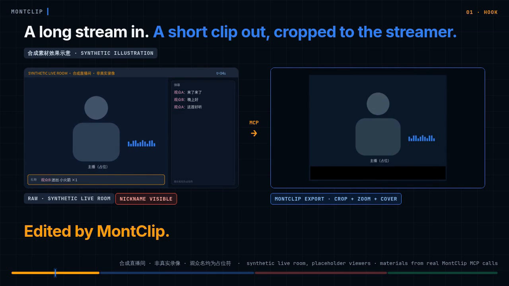

# MontClip

**MontClip：给剪自己直播的主播用的剪辑软件。** 导入直播录像，按字幕一句一句挑出想留的部分，导出 MP4 和字幕。按句选段和字幕导出还在验证；现在能用的是导入和导出 MP4。

目前还没有安装包，需要从源码运行。[怎么开始](#怎么开始) · [现在能做的](#现在能做的) · [计划中](#计划中) · [English](../../README.md)

基于 [ronak-create/FableCut](https://github.com/ronak-create/FableCut)（MIT 许可）。

<p align="center">
  
  <br><sub>演示片（22 秒，合成素材，不是真实录像）。<a href="https://github.com/good-night-oppie/MontClip/releases/tag/readme-demo-2026-11-07">观看演示片</a></sub>
</p>

## 现在能做的

- **导入本地录像**：把电脑里的视频文件导进项目。
- **导出 MP4**：导出成片 MP4。

录像默认在你的电脑上处理。联网只发生在你自己打开的功能里，发之前先给你看。

## 怎么开始

目前还没有安装包，需要用开发者方式从源码运行。

需要先装好：

- [Git](https://git-scm.com/downloads)（用来下载 MontClip）
- [Node.js](https://nodejs.org/) 18 或更新
- Chromium 内核的浏览器（Chrome 或 Edge）
- 建议装 [FFmpeg](https://ffmpeg.org/download.html) 6.0 或更新，用来快速导出；没装或太旧的话，MontClip 会提示你

这些步骤目前有人在 Windows 11 上照着走过一遍；在 Linux 上只试过启动。

然后在终端里运行：

```bash
git clone https://github.com/good-night-oppie/MontClip.git
cd MontClip
node server.js
```

用浏览器打开 <http://localhost:7777>。用的时候别关掉那个终端窗口。一开始是一个空项目。要导入视频，把它拖进窗口，或者点 **+ 导入**；看不到这个按钮的话，先点开 **素材** 面板。如果终端报 `EADDRINUSE`，说明 7777 端口已经被占用，常见原因是之前开的 MontClip 还在运行。先把它关掉，不然打开的会是旧的那个。项目和导出的文件默认存在 `server.js` 旁边；想存到别处，见 [DEVELOPMENT.md](../../DEVELOPMENT.md)。

## 计划中

下面这些还在做，或者还没验证完，现在不能用：

- 按句选段：还在验证，验证完才算数。
- 导出配套的 SRT 字幕文件：还在验证。
- 可选的 AI 助手（发送前先给你看内容）：还在验证。
- 更多中文界面（部分面板和弹窗还是英文）
- 安装包（目前需要开发者方式运行）
- 中文按单个字词剪辑（现在中文听写只有整句的时间）
- macOS 和 Linux 版本（还没有完整验证；Linux 上目前只试过启动）

## 关于上游

MontClip 基于 FableCut 修改而来，并沿用它的 MIT 许可。FableCut 本身还有很多功能，MontClip 没有逐一验证，所以这里不列出。想了解可以看 [上游 FableCut 文档](https://github.com/ronak-create/FableCut)。

## 许可

MIT。详见 [LICENSE](../../LICENSE) 和[第三方许可说明](../../LICENSES.md)。

## 给开发者

从源码运行的详细说明：[DEVELOPMENT.md](../../DEVELOPMENT.md)。架构示意图、导出和智能体/API 说明：[技术参考](../technical-reference.md)（英文）。
