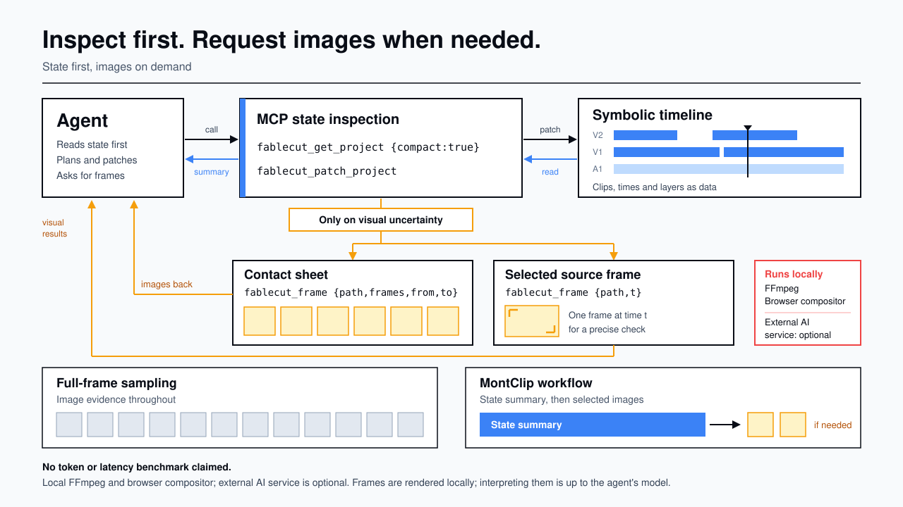
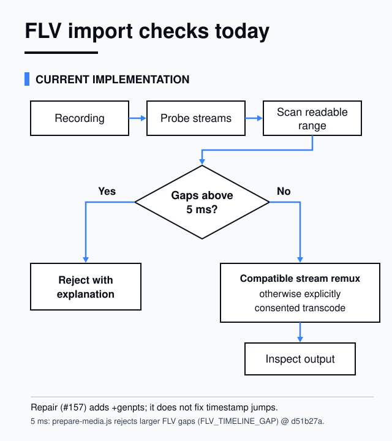

# MontClip technical reference

For developers and agent integrations. This page used to be the second half of the [README](../README.md); the content is unchanged, only moved.

- How to run MontClip from source: [DEVELOPMENT.md](../DEVELOPMENT.md)
- Agent and API manual: [CLAUDE.md](../CLAUDE.md)
- 中文说明见 [README（中文）](i18n/README.zh-CN.md)；本页技术内容暂只有英文。

## Diagrams

<picture>
  <source media="(prefers-color-scheme: dark)" srcset="assets/diagrams/symbolic-perception-arch-dark.svg">
  
</picture>

<picture>
  <source media="(prefers-color-scheme: dark)" srcset="assets/diagrams/flv-input-checks-dark.svg">
  
</picture>

See the [agent and API manual](../CLAUDE.md) for media repair and background duration merging, and the [timestamp repair comparison](testing/repair-timestamp-jump.md) for the reproducible test and its limits.

JPEG ProRes exports use the selected range's frame count to preserve audio through
the project end. Direct REST callers can supply `frames` with `fps`; see the
[export boundary decision](decisions/2026-11-05-prores-project-end.md) for scope and compatibility.
Bounded ProRes preserves filters selected by the output stream index, including
muted audio after explicit stream reordering. Unsupported mappings or filter
selectors are refused instead of silently replacing an existing audio filter.

A busy visible editor keeps its queued job. Silent hidden or disconnected editors release the queue after 20 seconds; the busy response includes cancellation instructions.

Agent speech/song/highlight tools support bounded waits and saved task results; retries with an idempotency key do not duplicate edits. Completed transcript paragraphs remain on disk after cancellation. See the [agent manual](../CLAUDE.md) for the same-tool retrieval contract.

Incomplete transcription replies identify saved paragraphs with data-root-relative
paths such as `analysis/transcripts/name.json`. Direct and bounded tool calls use
the same incomplete-work notice; local absolute paths stay out of that notice and
the `saved` field. Local clients resolve these paths against their own data root.
Tool error text, including warnings inside normal replies, uses one redaction
boundary. Older terminal task receipts are scrubbed on disk before replay;
the operation itself is never repeated.

Picture-only `updateClip` replacements retain matching recorded audio links
across save/reopen. Roll edits keep the original sound continuous across the
cut, or refuse atomically when source handles or continuity cannot be preserved.
Explicitly unlinked audio stays independent; mixed-source links already lost in
older files are not guessed from overlap. See the [timeline edit contract](../CLAUDE.md#timeline-edit-ops-fablecut_patch_project)
and [#285 validation evidence](validation/issue285/README.md).
