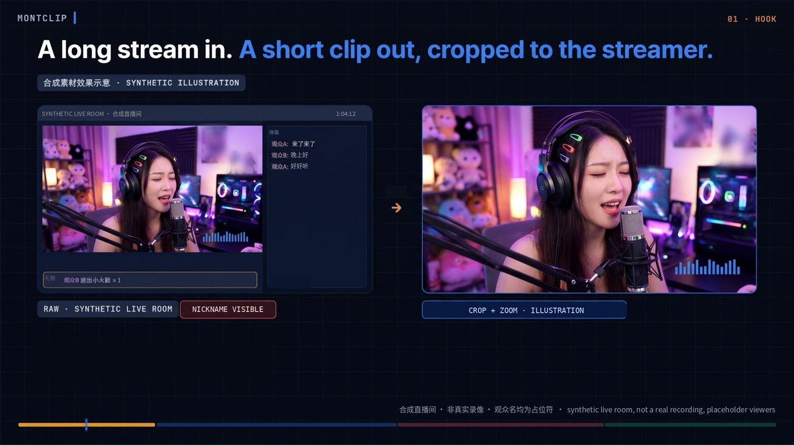
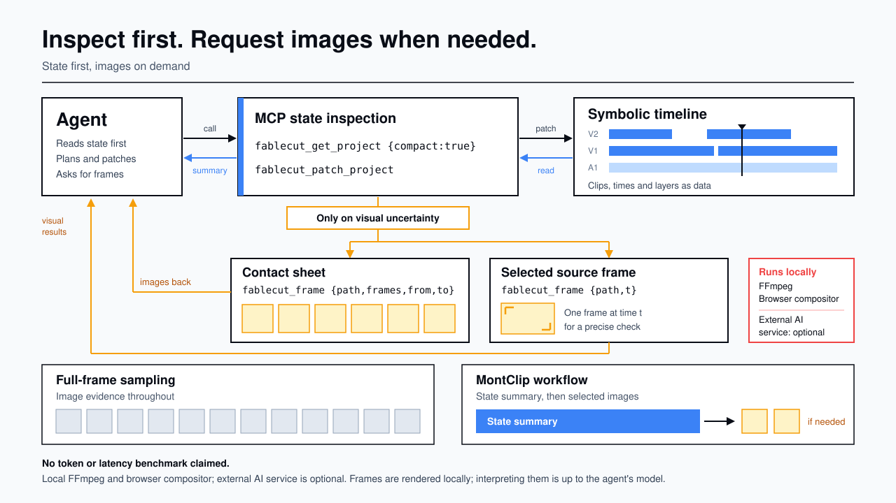
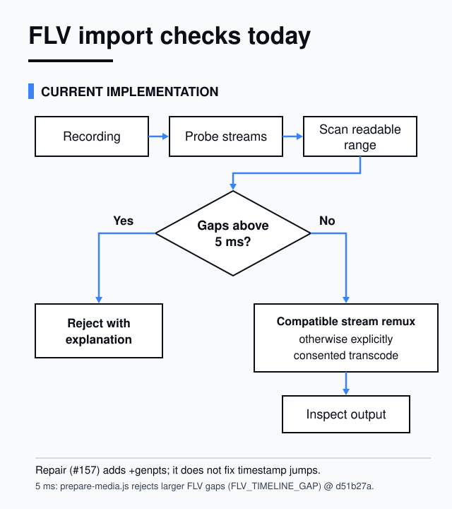

# MontClip 对外文案（README / docs 首页 / docs/start 下载页）中英 v2

作者：JJ　日期：2026-11-02　交给：Deja（实施侧照原样落到 PR #31，JJ 再按增量核）
依据：Deja 11-02 给定的「已验证能力」清单；主人原话「我们不应该是 MontClip 吗？」；关键安全句 §6、§8。

版本：v2 = v1 全文（sha256 3ec69dbf9c2ca9b670530f97d3ad09fb6bba0030c9fc7b654f8d158ac8d57d26，JJ 2026-11-02）+ README 的封面图与两张示意图（JJ 2026-11-07 定稿，PR #201 issuecomment-6699400448）；2026-11-07 按 Deja 裁定 issuecomment-6704689435 把两张示意图挪到「Technical reference / 技术参考」一节，节标题与小标题见 JJ issuecomment-6704704979，发布后封面说明行见 JJ issuecomment-6704713780；封面换成修好的合成示意图（PR #211），替代文字沿用 JJ feec22de，说明行见 JJ #211 issuecomment-6704782433。v1 文件保留不改。

## 落地规则（实施必读，不进页面）

1. 页面里只能出现本文的句子；不得把上游 FableCut 的宣传句、功能清单、评价引语、赞助商、徽章、演示视频搬回来。
2. 禁止出现：免费 / free、无需安装 / nothing to install、零依赖 / zero dependencies、在浏览器里运行 / runs in your browser、逐词 / 选词删除 / word-level、任何准确率数字、任何没验证过的功能名。
3. `{repo}` = https://github.com/good-night-oppie/MontClip ；`{upstream}` = https://github.com/ronak-create/FableCut ；`{upstream-docs}` = 上游文档地址（实施侧给出实际可访问的链接；没有就链 `{upstream}`）。
4. 「计划中」小节必须单独成节，不能和已验证能力混在一个列表里。
5. 下载页：在有正式安装包之前，「下载」按钮不出现；只写「安装包准备中」。有了以后，按钮文字和版本号由 Deja 给，我再审。
6. 结构化数据（JSON-LD）里的 name / url / downloadUrl / codeRepository 指向 MontClip 自己（`{repo}`），不指向 fablecut.space 或上游仓库；`isAccessibleForFree` 字段删除。
7. 「已验证能力」以合入 main 的版本为准。如果发布时可选 AI 助手（PR #26）还没合入，把该条移到「计划中」。

---

## 1. README.md（开头 + 正文）

### 中文版（docs/i18n/README.zh-CN.md）

```markdown
# MontClip

给剪自己直播的主播用的视频剪辑软件。中文优先，可切换英文。

基于 [ronak-create/FableCut]({upstream})（MIT 许可）。

<p align="center">
  
  <br><sub>上图是合成示意图，不是 MontClip 导出的画面。演示片（22 秒，合成素材，不是真实录像）：<a href="https://github.com/good-night-oppie/MontClip/releases/tag/readme-demo-2026-11-07">观看演示片</a></sub>
</p>

## MontClip 是什么

MontClip 是一个装在自己电脑上用的剪辑软件。你把直播录像导进来，按字幕一句一句挑出想留的部分，导出成片和字幕文件。录像只在你的电脑上处理，不会上传。

## 现在能做的

- **导入本地录像**：把电脑里的视频文件导进项目。
- **按句选段**：有字幕时，勾选想保留的句子，软件会把它们按顺序接起来。可以先试听，再应用；一步就能撤销，原文件不会被改动。
- **导出 MP4 和字幕**：导出成片 MP4，同时导出对应的 SRT 字幕文件。
- **可选的 AI 助手**：可以连接你自己的 AI 服务账号，让它帮你提剪辑建议。每次发送前会先给你看要发出去的文字；建议要你点「应用」才会改片子，也能撤销。不连接也能正常剪辑。使用 AI 服务的费用由你自己的账号承担。

## 计划中

下面这些还在做，或者还没验证完，现在不能用：

- 更多中文界面（部分面板和弹窗还是英文）
- 安装包（目前需要开发者方式运行）
- 中文按单个字词剪辑（现在中文听写只有整句的时间）
- macOS 和 Linux 版本（目前只在 Windows 上测试过）

## 关于上游

MontClip 基于 FableCut 修改而来，并沿用它的 MIT 许可。FableCut 本身还有很多功能，MontClip 没有逐一验证，所以这里不列出。想了解可以看 [上游 FableCut 文档]({upstream-docs})。

## 许可

MIT。详见 [LICENSE](LICENSE) 和第三方许可说明。

## 技术参考

### 示意图（给开发者）

<picture>
  <source media="(prefers-color-scheme: dark)" srcset="../../docs/assets/diagrams/symbolic-perception-arch-dark.svg">
  
</picture>

<picture>
  <source media="(prefers-color-scheme: dark)" srcset="../../docs/assets/diagrams/flv-input-checks-dark.svg">
  
</picture>
```

### English version (README.md)

```markdown
# MontClip

A video editor for streamers who cut their own streams. Chinese first, English one click away.

Based on [ronak-create/FableCut]({upstream}) (MIT).

<p align="center">
  
  <br><sub>The picture above is a synthetic illustration, not a frame exported by MontClip. Demo video (22 seconds, synthetic footage, not a real recording): <a href="https://github.com/good-night-oppie/MontClip/releases/tag/readme-demo-2026-11-07">Watch the demo video</a></sub>
</p>

## What MontClip is

MontClip is an editor you install and run on your own computer. Bring in your stream recordings, pick the parts you want to keep sentence by sentence from the subtitles, and export the finished clip with its subtitle file. Your recordings are processed on your computer and are not uploaded.

## What it can do today

- **Import local recordings**: add video files from your computer to a project.
- **Keep by sentence**: when subtitles are available, tick the sentences you want to keep and MontClip joins them in order. Preview first, then apply; one Undo reverts it, and your original files are never changed.
- **Export MP4 and subtitles**: export the finished clip as MP4, together with a matching SRT subtitle file.
- **Optional AI assistant**: connect your own AI service account and ask it for editing suggestions. Before every send you see the exact text that will go out; a suggestion only changes your clip when you click Apply, and it can be undone. Editing works fine without it. Service charges are billed to your own AI account.

## Planned

These are still in progress or not yet verified, and are not available now:

- More of the interface in Chinese (some panels and dialogs are still in English)
- An installer (for now MontClip runs the developer way)
- Cutting Chinese by individual words (Chinese transcription currently has sentence-level timing only)
- macOS and Linux versions (only tested on Windows so far)

## About the upstream project

MontClip is a modified version of FableCut and keeps its MIT license. FableCut has many more features that MontClip has not verified one by one, so they are not listed here. See the [upstream FableCut documentation]({upstream-docs}).

## License

MIT. See [LICENSE](LICENSE) and the third-party notices.

## Technical reference

### Diagrams (for developers)

<picture>
  <source media="(prefers-color-scheme: dark)" srcset="docs/assets/diagrams/symbolic-perception-arch-dark.svg">
  
</picture>

<picture>
  <source media="(prefers-color-scheme: dark)" srcset="docs/assets/diagrams/flv-input-checks-dark.svg">
  
</picture>
```

---

## 2. docs/index.html 首页

页面结构：标题 → 一句话 → 「基于 FableCut」 → 现在能做的（4 张卡）→ 计划中（单独一节）→ 关于上游 → 页脚。不放评价、赞助、演示视频、徽章。

### 中文

| 位置 | 文字 |
|---|---|
| `<title>` | MontClip · 给主播的直播切片剪辑软件 |
| meta description | 装在自己电脑上的剪辑软件：导入直播录像，按字幕逐句挑出想留的部分，导出 MP4 和 SRT 字幕。录像不上传。 |
| 主标题 | MontClip |
| 副标题 | 把直播录像剪成切片，按句挑，挑完就导出。 |
| 基于 | 基于 FableCut（MIT 许可）修改而来。 |
| 主按钮 | 查看源码 → `{repo}` |
| 次按钮 | 怎么开始 → `start/` |
| 小节标题 | 现在能做的 |
| 卡 1 标题 / 正文 | 导入本地录像 / 把电脑里的视频文件导进项目。录像只在你的电脑上处理。 |
| 卡 2 标题 / 正文 | 按句选段 / 勾选想留的字幕句子，软件按顺序接好。先试听再应用，一步撤销，原文件不动。 |
| 卡 3 标题 / 正文 | 导出 MP4 和字幕 / 导出成片 MP4，同时导出对应的 SRT 字幕文件。 |
| 卡 4 标题 / 正文 | 可选的 AI 助手 / 连接你自己的 AI 服务账号，让它提剪辑建议。发送前先给你看要发的文字；点「应用」才会改，可以撤销。费用由你自己的账号承担。不连接也能正常剪辑。 |
| 小节标题 | 计划中 |
| 计划中说明 | 下面这些还在做，或者还没验证完，现在不能用。 |
| 计划中列表 | 更多中文界面 · 安装包 · 中文按单个字词剪辑 · macOS 和 Linux 版本 |
| 小节标题 | 关于上游 |
| 关于上游正文 | MontClip 基于 FableCut 修改，沿用 MIT 许可。FableCut 还有很多功能，MontClip 没有逐一验证，这里不列出。 |
| 链接 | 上游 FableCut 文档 → `{upstream-docs}` |
| 页脚 | MontClip · MIT 许可 · 基于 FableCut |

### English

| Position | Text |
|---|---|
| `<title>` | MontClip · A clip editor for streamers |
| meta description | An editor that runs on your own computer: import stream recordings, keep the parts you want sentence by sentence from the subtitles, and export MP4 with SRT subtitles. Recordings are not uploaded. |
| Heading | MontClip |
| Subheading | Turn stream recordings into clips. Pick by sentence, then export. |
| Based on | A modified version of FableCut (MIT). |
| Primary button | View source → `{repo}` |
| Secondary button | Get started → `start/` |
| Section | What it can do today |
| Card 1 | Import local recordings / Add video files from your computer to a project. Recordings are processed on your computer. |
| Card 2 | Keep by sentence / Tick the subtitle sentences you want to keep and MontClip joins them in order. Preview, then apply; one Undo reverts it, and your original files are never changed. |
| Card 3 | Export MP4 and subtitles / Export the finished clip as MP4, with a matching SRT subtitle file. |
| Card 4 | Optional AI assistant / Connect your own AI service account and ask it for editing suggestions. You see the text before it is sent; nothing changes until you click Apply, and it can be undone. Charges are billed to your own account. Editing works fine without it. |
| Section | Planned |
| Planned note | These are still in progress or not yet verified, and are not available now. |
| Planned list | More of the interface in Chinese · An installer · Cutting Chinese by individual words · macOS and Linux versions |
| Section | About the upstream project |
| Upstream text | MontClip is a modified version of FableCut and keeps its MIT license. FableCut has many more features that MontClip has not verified one by one, so they are not listed here. |
| Link | Upstream FableCut documentation → `{upstream-docs}` |
| Footer | MontClip · MIT license · Based on FableCut |

---

## 3. docs/start 下载页

在有正式安装包之前，按本节「安装包准备中」版本落地。页面里不出现命令行步骤；开发者运行方式只放在 README 和仓库文档里。

### 中文

| 位置 | 文字 |
|---|---|
| `<title>` | 开始使用 · MontClip |
| 主标题 | 开始使用 MontClip |
| 状态框标题 | 安装包准备中 |
| 状态框正文 | 现在还没有可以直接双击安装的版本。做好之后会放在这一页，并写明版本号和支持的系统。 |
| 小节标题 | 系统要求 |
| 系统要求正文 | 目前只在 Windows 11 上测试过。macOS 和 Linux 还没有测试。 |
| 小节标题 | 你的录像去哪了 |
| 录像说明 | 导入、剪辑、导出都在你的电脑上完成，录像不会上传。 |
| 小节标题 | 关于 AI 助手 |
| AI 说明 | AI 助手是可选的。要用的话，在软件里连接你自己的 AI 服务账号，费用由该账号承担。每次发送前会先给你看要发出去的文字。不连接也能正常剪辑。 |
| 小节标题 | 常见问题 |
| 问 1 | MontClip 和 FableCut 是什么关系？ |
| 答 1 | MontClip 基于 FableCut 修改，沿用 MIT 许可。FableCut 的完整功能见 上游 FableCut 文档（链接 `{upstream-docs}`）；那些功能 MontClip 没有逐一验证。 |
| 问 2 | 中文能按单个字词剪吗？ |
| 答 2 | 现在还不能。中文听写目前只有整句的时间，可以按句剪。按字词剪还在验证。 |
| 问 3 | 需要登录或注册吗？ |
| 答 3 | 剪辑本身不需要。只有使用 AI 助手时，才需要你自己的 AI 服务账号。 |
| 返回链接 | ← 回到首页 |

### English

| Position | Text |
|---|---|
| `<title>` | Get started · MontClip |
| Heading | Get started with MontClip |
| Status box title | Installer in preparation |
| Status box body | There is no ready-to-install version yet. When it is ready, it will be posted on this page with its version number and supported systems. |
| Section | System requirements |
| Requirements | Tested on Windows 11 only so far. macOS and Linux have not been tested. |
| Section | Where your recordings go |
| Recordings | Importing, editing and exporting all happen on your computer. Recordings are not uploaded. |
| Section | About the AI assistant |
| AI note | The AI assistant is optional. To use it, connect your own AI service account in the app; charges are billed to that account. Before each send you see the text that will go out. Editing works fine without it. |
| Section | FAQ |
| Q1 | How is MontClip related to FableCut? |
| A1 | MontClip is a modified version of FableCut and keeps its MIT license. For FableCut's full feature set, see the upstream FableCut documentation (`{upstream-docs}`); MontClip has not verified those features one by one. |
| Q2 | Can I cut Chinese by individual words? |
| A2 | Not yet. Chinese transcription currently has sentence-level timing only, so you can cut by sentence. Word-level cutting is still being verified. |
| Q3 | Do I need to sign in or register? |
| A3 | Not for editing. You only need your own AI service account if you use the AI assistant. |
| Back link | ← Back to home |

---

## 4. 等 Deja 确认的（不影响落地）

- `{upstream-docs}` 的实际地址。
- 「录像不上传」这一句，依据是默认零网络、AI 只发文字。如果发布版本里还有其它联网功能（例如「从网址导入」），这句要改成「导入和剪辑都在你的电脑上完成；只有你主动用 AI 助手或网址导入时才会联网」，或者把网址导入在发布版里关掉。
- 导入格式：本文只写「视频文件」，不列格式名。FLV 等录播格式的支持情况，等实测结果出来再补。
